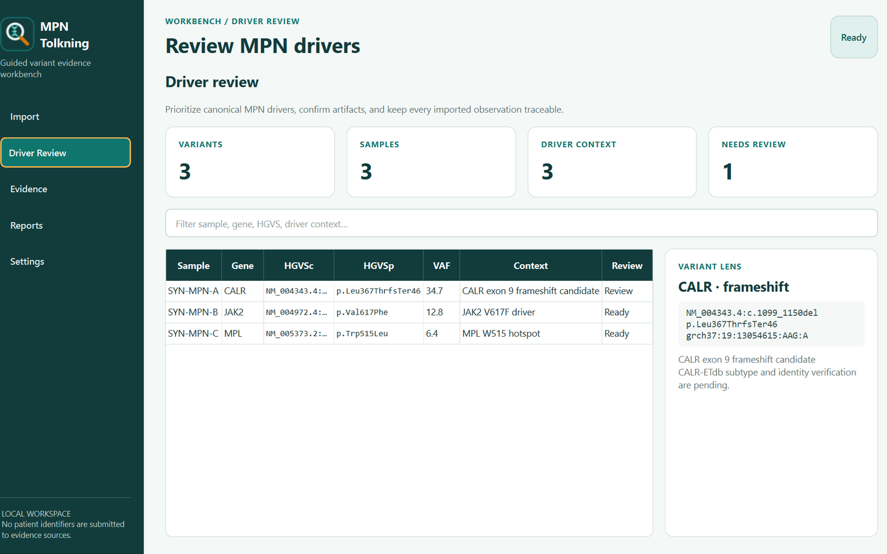

# MPN Tolkning



MPN Tolkning is a Windows workstation for review-first analysis of processed Archer NGS panel variants, focused on **JAK2, CALR, and MPL**. It imports a tab-separated variant file, adds MPN driver context, guides evidence collection, and produces review and per-patient Excel workbooks.

> MPN Tolkning is an interpretation-support and research tool. Qualified laboratory personnel must review every identity match, evidence capture, classification, and report before clinical use.

## Workflow

1. Import an Archer processed-variant TSV. Original columns are retained.
2. Review canonical MPN drivers, candidates, unexpected genes, and configurable artifact rules.
3. Confirm the review workbook and mark variants that should skip database search.
4. Collect database evidence in resumable patient/variant/provider units.
5. Review incremental patient workbooks and verified screenshots.

The interface is designed as a guided workbench rather than an automatic diagnostic system. A database result is complete only when the requested variant identity is verified; required browser sources also need a readable evidence capture.

## Evidence sources

The standard sequence is:

- **CALR-ETdb** — CALR-specific cDNA lookup, including guarded handling of the documented type-1 deletion alias.
- **MTBP** — isolated pseudonymous report workflow.
- **Franklin** — somatic, hg19/GRCh37 context with transcript-first lookup.
- **ClinVar** — exact GRCh37 chromosome, position, reference, and alternate identity.
- **OncoKB** — exact gene and alteration verification.
- **COSMIC** — imported COSV identifier preferred, with canonical GRCh37 verification.

ClinGen Allele Registry provides CAid normalization. CIViC and MetaKB are available as optional, disabled-by-default supplemental sources with exact-match safeguards.

## Privacy and operational safeguards

- Patient/sample identifiers are never submitted to CALR-ETdb or the five database search pages.
- CALR-ETdb receives only the `c.…` component of HGVS cDNA.
- MTBP uses a deterministic generated pseudonym rather than the imported sample ID.
- Each browser source uses a separate local Microsoft Edge profile.
- Evidence screenshot filenames contain a stable-key hash, not a patient identifier.
- Sign in through each provider's isolated Edge window; passwords are never written to the app's JSON settings file.
- Interrupted searches resume only incomplete patient/variant/provider units.
- If Excel locks a report, the completed payload remains pending and can be written later without repeating searches.

Review database terms, licensing, and organizational policy before using automated evidence collection, particularly for licensed services.

## Requirements

- Windows 10 or 11
- Python 3.12 or newer
- Microsoft Edge with local DevTools/remote debugging permitted by workstation policy
- Microsoft Excel or another `.xlsx` viewer for human review
- Valid organizational access for services that require an account or licence

## Installation

```powershell
git clone https://github.com/Christian-Bjornstad/MPN-Tolkning.git
cd MPN-Tolkning
py -3.12 -m venv .venv
.venv\Scripts\Activate.ps1
python -m pip install -r requirements-dev.lock
python -m pip install -e . --no-deps
mpn-tolkning
```

Application settings and browser profiles are stored under `%USERPROFILE%\.mpn-tolkning`. Reports are written to the selected output folder, or to `MPN_Output` beside the imported TSV.

## Development

```powershell
$env:QT_QPA_PLATFORM = "offscreen"
python -m pytest -q
python scripts/build_icons.py
```

The deterministic test suite uses synthetic fixtures and does not call live evidence sources.

## Database links and attribution

- [CALR-ETdb](https://www.dsimb.inserm.fr/CALR-ET/)
- [ClinVar](https://www.ncbi.nlm.nih.gov/clinvar/)
- [ClinGen Allele Registry](https://reg.clinicalgenome.org/)
- [CIViC](https://civicdb.org/)
- [MetaKB / Cancer Variant Knowledgebase](https://search.cancervariants.org/)
- [OncoKB](https://www.oncokb.org/)
- [COSMIC](https://cancer.sanger.ac.uk/cosmic)
- [Franklin](https://franklin.genoox.com/)
- [MTBP](https://mtbp.org/)

MPN Tolkning is independent software and is not endorsed by these services.
